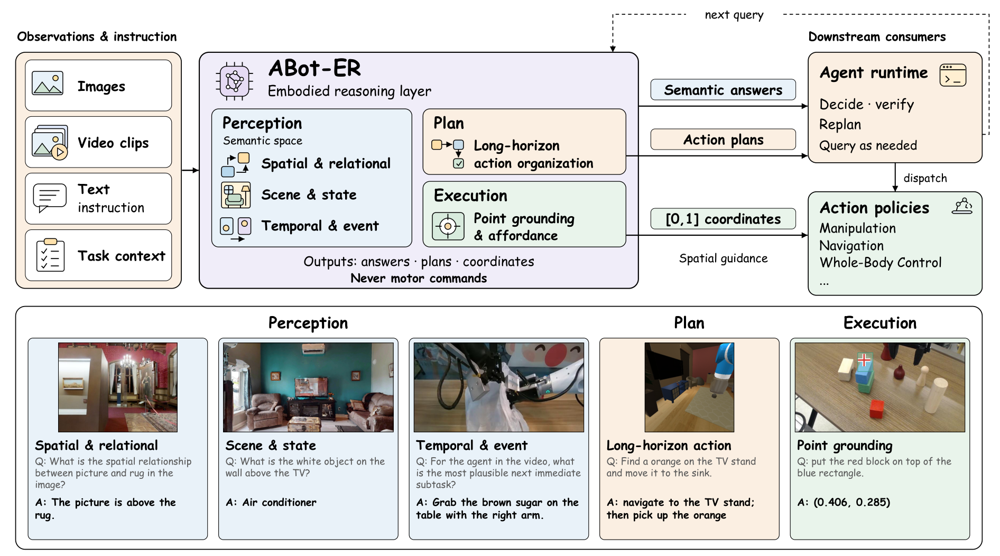
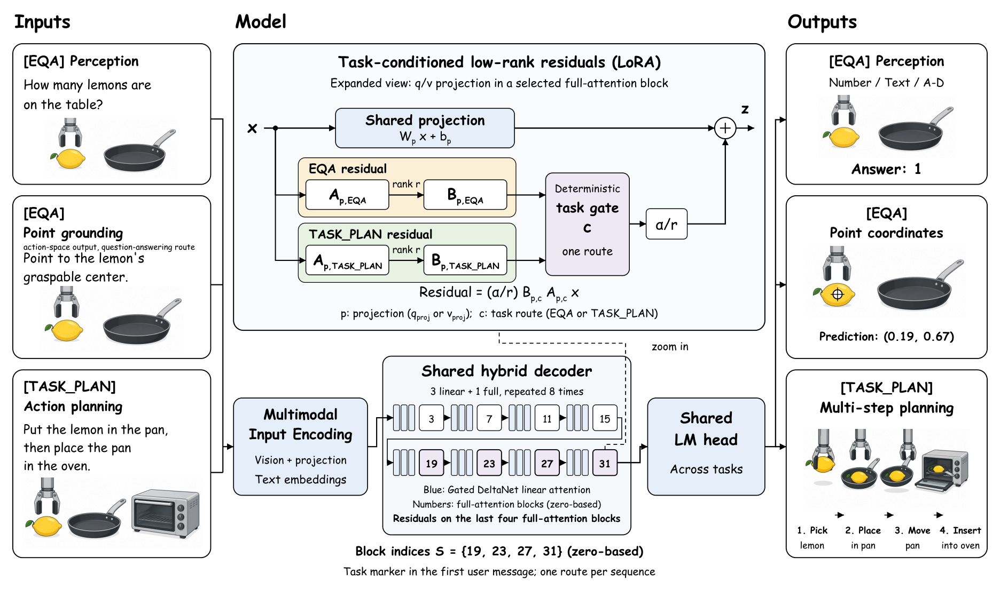
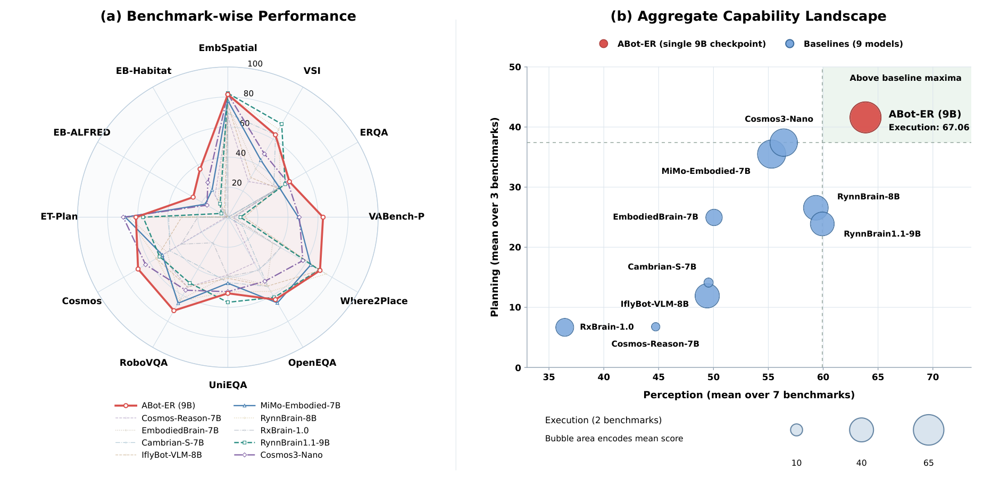
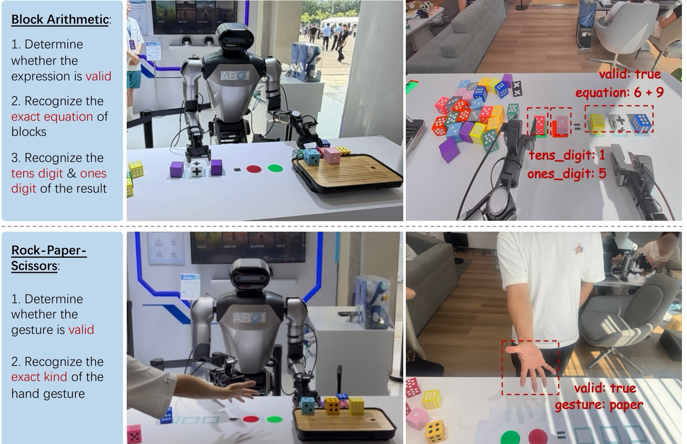

<div align="center">

# ABot-ER

### Embodied Understanding and Task Planning

[](https://arxiv.org/abs/2610.18355)
[](https://arxiv.org/pdf/2610.18355)
[](https://amap-cvlab.github.io/ABot-ER/)
[](LICENSE)
[](https://www.modelscope.cn/datasets/amap_cvlab/ABot-ER-Training-Data)
[](https://www.modelscope.cn/collections/amap_cvlab/ABot-ER)

[](https://huggingface.co/datasets/acvlab/ABot-ER-Training-Data)
[](https://huggingface.co/collections/acvlab/abot-er)

ABot-ER model pages and training data are now public on Hugging Face. The 35B-A3B page links to ModelScope for weight downloads.

**English** | [简体中文](README.zh-CN.md)

[Results](#benchmark-results) · [Models](#models) · [Datasets](#datasets) · [Setup](#setup) · [Training](#training) · [Evaluation](#evaluation) · [Documentation](docs/README.md)

</div>

ABot-ER brings embodied visual understanding and long-horizon task planning into a shared vision-language model. It covers five capability dimensions: spatial relations, scene states, temporal events, point grounding and affordances, and action organization.

This repository provides the **Task-Conditioned Adaptive Training Strategy** implementation, two-stage training recipes, versioned training-data manifests, and evaluation interfaces for nine embodied QA and three task-planning benchmarks.

Models and training data are available through the Hugging Face badges above and the ModelScope links in [Models](#models) and [Datasets](#datasets). The Hugging Face training-data repository includes both pre-training and post-training data.

## Overview

<p align="center">
  <a href="docs/assets/paper/capability-overview.png"></a>
</p>

*Figure 2 from the report. One shared reasoning model covers five capabilities. It produces answers, plans, and coordinates; the agent runtime and downstream policies execute actions. The example cards are evaluation cases, not training examples.*

- **Shared model, task-conditioned adaptation.** The strategy adds task-conditioned low-rank residuals to selected attention projections while retaining a trainable shared language backbone.
- **Two-stage training.** Joint domain SFT establishes capability coverage; a single subsequent SFT run uses the sealed joint post-training dataset.
- **Traceable data and checkpoints.** Recipes reference immutable data manifests, shard checksums, and explicit checkpoint ancestry.
- **Benchmark-specific evaluation.** The evaluation interfaces preserve the original prompts, parsers, scorers, and task-routing behavior.

| Capability | Benchmarks |
| --- | --- |
| Spatial & Relational Reasoning | EmbSpatial, VSI, ERQA |
| Scene & State Understanding | OpenEQA, UniEQA, RoboVQA |
| Temporal & Event Reasoning | Cosmos |
| Point Grounding & Affordance | VABench-P, Where2Place |
| Long-Horizon Action Organization | ET-Plan-Bench, EB-ALFRED, EB-Habitat |

### Model architecture

<p align="center">
  <a href="docs/assets/paper/model-architecture.png"></a>
</p>

*Figure 3. The 9B implementation adds task-conditioned Q/V residuals at zero-indexed layers 19, 23, 27, and 31. A sequence uses one deterministic route. The figure's EQA label corresponds to the implementation token `[2D_QA]`; planning uses `[TASK_PLAN]`. Click any figure to inspect the full-resolution image.*

## Benchmark Results

<p align="center">
  <a href="docs/assets/paper/benchmark-overview.png"></a>
</p>

*Figure 1. Left: twelve-benchmark comparison. Right: perception and planning means, with bubble area representing execution mean. Comparisons use the nine baselines listed below; radar area is not an aggregate score.*

### Main results — ABot-ER 9B

Results from Table 8 of the [technical report](https://arxiv.org/abs/2610.18355).

**6 / 12 benchmarks lead the listed baselines** · **EQA 64.57** · **Planning 41.61**

Scores use a 0–100 scale; higher is better. Expand the full comparison below for all twelve benchmarks and the listed baselines.

<details>
<summary><strong>Full comparison · all 10 models across five capability dimensions</strong></summary>

Each model has valid results on all twelve benchmarks. **Bold** marks the best listed score for each benchmark or aggregate; `--` is a valid zero included in the means.

#### Spatial & Relational

| Model | EmbSpatial | VSI | ERQA |
| --- | ---: | ---: | ---: |
| **ABot-ER 9B** | 81.68 | 63.30 | **47.31** |
| Cosmos Reason 7B | 66.96 | 27.41 | 40.28 |
| EmbodiedBrain 7B | 74.37 | 37.05 | 38.27 |
| Cambrian-S 7B | 69.13 | 63.39 | 35.23 |
| IflyBot-VLM 8B | 75.05 | 30.47 | 38.38 |
| Mimo-Embodied 7B | 77.59 | 43.86 | 39.50 |
| RynnBrain 8B | 81.46 | 67.55 | 40.40 |
| Hy-Emb. RxBrain 1.0 | 80.38 | 0.16 | 38.58 |
| RynnBrain 1.1 9B | **82.53** | **71.59** | 44.02 |
| Cosmos3 Nano | 82.03 | 48.65 | 46.09 |

#### Scene & State

| Model | OpenEQA | UniEQA | RoboVQA |
| --- | ---: | ---: | ---: |
| **ABot-ER 9B** | 63.33 | 50.66 | **71.79** |
| Cosmos Reason 7B | 35.17 | 38.38 | 53.75 |
| EmbodiedBrain 7B | 51.79 | 39.02 | 63.19 |
| Cambrian-S 7B | 53.19 | 43.50 | 37.77 |
| IflyBot-VLM 8B | 52.95 | 40.63 | 53.60 |
| Mimo-Embodied 7B | **65.85** | 43.93 | 66.09 |
| RynnBrain 8B | 57.06 | 49.68 | 64.31 |
| Hy-Emb. RxBrain 1.0 | 40.90 | 39.51 | 19.66 |
| RynnBrain 1.1 9B | 61.60 | **56.62** | 50.63 |
| Cosmos3 Nano | 49.22 | 49.57 | 56.08 |

#### Temporal & Event

| Model | Cosmos |
| --- | ---: |
| **ABot-ER 9B** | **68.96** |
| Cosmos Reason 7B | 51.13 |
| EmbodiedBrain 7B | 46.68 |
| Cambrian-S 7B | 44.61 |
| IflyBot-VLM 8B | 54.95 |
| Mimo-Embodied 7B | 50.27 |
| RynnBrain 8B | 54.84 |
| Hy-Emb. RxBrain 1.0 | 35.89 |
| RynnBrain 1.1 9B | 52.42 |
| Cosmos3 Nano | 63.18 |

#### Task Planning

| Model | ET-Plan | EB-ALFRED | EB-Habitat |
| --- | ---: | ---: | ---: |
| **ABot-ER 9B** | 61.15 | **26.67** | **37.00** |
| Cosmos Reason 7B | 1.32 | 2.00 | 17.00 |
| EmbodiedBrain 7B | 65.89 | 0.33 | 8.67 |
| Cambrian-S 7B | 39.35 | -- | 3.00 |
| IflyBot-VLM 8B | 30.75 | 0.33 | 4.67 |
| Mimo-Embodied 7B | 68.17 | 17.33 | 21.00 |
| RynnBrain 8B | 66.39 | 0.33 | 13.00 |
| Hy-Emb. RxBrain 1.0 | 20.02 | -- | -- |
| RynnBrain 1.1 9B | 56.35 | 5.00 | 10.33 |
| Cosmos3 Nano | **69.55** | 16.00 | 26.67 |

#### Point & Affordance

| Model | VABench-P | Where2Place |
| --- | ---: | ---: |
| **ABot-ER 9B** | **63.33** | 70.79 |
| Cosmos Reason 7B | 4.33 | 5.21 |
| EmbodiedBrain 7B | 2.58 | 34.45 |
| Cambrian-S 7B | 0.50 | 10.94 |
| IflyBot-VLM 8B | 11.08 | 70.76 |
| Mimo-Embodied 7B | 46.90 | 63.60 |
| RynnBrain 8B | 9.00 | **75.48** |
| Hy-Emb. RxBrain 1.0 | 3.58 | 40.50 |
| RynnBrain 1.1 9B | 8.38 | 70.20 |
| Cosmos3 Nano | 47.54 | 57.68 |

#### Aggregate scores

| Model | Perception (7) | Planning (3) | Execution (2) |
| --- | ---: | ---: | ---: |
| **ABot-ER 9B** | **63.86** | **41.61** | **67.06** |
| Cosmos Reason 7B | 44.73 | 6.77 | 4.77 |
| EmbodiedBrain 7B | 50.05 | 24.96 | 18.52 |
| Cambrian-S 7B | 49.55 | 14.12 | 5.72 |
| IflyBot-VLM 8B | 49.43 | 11.92 | 40.92 |
| Mimo-Embodied 7B | 55.30 | 35.50 | 55.25 |
| RynnBrain 8B | 59.33 | 26.57 | 42.24 |
| Hy-Emb. RxBrain 1.0 | 36.44 | 6.67 | 22.04 |
| RynnBrain 1.1 9B | 59.92 | 23.89 | 39.29 |
| Cosmos3 Nano | 56.40 | 37.41 | 52.61 |

| Model | EQA (9) | All (12) |
| --- | ---: | ---: |
| **ABot-ER 9B** | **64.57** | **58.83** |
| Cosmos Reason 7B | 35.85 | 28.58 |
| EmbodiedBrain 7B | 43.04 | 38.52 |
| Cambrian-S 7B | 39.81 | 33.38 |
| IflyBot-VLM 8B | 47.54 | 38.63 |
| Mimo-Embodied 7B | 55.29 | 50.34 |
| RynnBrain 8B | 55.53 | 48.29 |
| Hy-Emb. RxBrain 1.0 | 33.24 | 26.60 |
| RynnBrain 1.1 9B | 55.33 | 47.47 |
| Cosmos3 Nano | 55.56 | 51.02 |

</details>

**Aggregation.** Perception (7) comprises spatial, scene, and temporal benchmarks; Execution (2) comprises VABench-P and Where2Place. Together they form EQA (9). Planning (3) comprises ET-Plan, EB-ALFRED, and EB-Habitat. Each mean weights its constituent benchmarks equally. All (12) is the twelve-benchmark mean—not the average of EQA (9) and Planning (3). It mixes score-like and success-rate metrics and should be read alongside the individual results.

### Scaling — one-pass recipe

Results from Table 10 of the [technical report](https://arxiv.org/abs/2610.18355).

Every model uses **one Stage A pass and one Stage B pass on the same two releases**, at its own best checkpoint. Bold marks the best score across sizes. These are reported experimental results, not a claim that independent reproduction validation is complete.

| Model | EQA (9) | Planning (3) | All (12) |
| --- | ---: | ---: | ---: |
| 2B | 55.20 | 34.14 | 49.93 |
| 4B | 61.80 | 41.69 | 56.77 |
| 9B | 64.57 | 41.61 | 58.83 |
| 27B | **66.23** | **51.59** | **62.57** |
| 35B-A3B | 65.39 | 46.48 | 60.66 |

<details>
<summary><strong>Full scaling results · 12 benchmarks and capability means</strong></summary>

#### Spatial & Relational

| Benchmark ↑ | 2B | 4B | 9B | 27B | 35B-A3B |
| --- | ---: | ---: | ---: | ---: | ---: |
| EmbSpatial | 78.87 | 79.53 | 81.68 | 82.39 | **82.69** |
| VSI | 49.85 | 58.85 | 63.30 | 65.62 | **66.85** |
| ERQA | 36.93 | 40.36 | 47.31 | **49.65** | 47.84 |

#### Scene & State

| Benchmark ↑ | 2B | 4B | 9B | 27B | 35B-A3B |
| --- | ---: | ---: | ---: | ---: | ---: |
| OpenEQA | 56.21 | 60.10 | 63.33 | **67.25** | 65.33 |
| UniEQA | 44.43 | 48.50 | 50.66 | **53.45** | 52.60 |
| RoboVQA | 68.64 | 72.32 | 71.79 | 73.39 | **74.22** |

#### Temporal & Event

| Benchmark ↑ | 2B | 4B | 9B | 27B | 35B-A3B |
| --- | ---: | ---: | ---: | ---: | ---: |
| Cosmos | 55.58 | 68.69 | **68.96** | 67.71 | 65.73 |

#### Task Planning

| Benchmark ↑ | 2B | 4B | 9B | 27B | 35B-A3B |
| --- | ---: | ---: | ---: | ---: | ---: |
| ET-Plan | 64.41 | 60.75 | 61.15 | **69.11** | 67.77 |
| EB-ALFRED | 13.67 | 30.00 | 26.67 | **37.00** | 31.00 |
| EB-Habitat | 24.33 | 34.33 | 37.00 | **48.67** | 40.67 |

#### Point & Affordance

| Benchmark ↑ | 2B | 4B | 9B | 27B | 35B-A3B |
| --- | ---: | ---: | ---: | ---: | ---: |
| VABench-P | 54.00 | 61.33 | **63.33** | 62.67 | 62.33 |
| Where2Place | 52.26 | 66.47 | 70.79 | **73.90** | 70.91 |

#### Capability means

| Model | Perception (7) | Execution (2) |
| --- | ---: | ---: |
| 2B | 55.79 | 53.13 |
| 4B | 61.19 | 63.90 |
| 9B | 63.86 | 67.06 |
| 27B | **65.64** | **68.29** |
| 35B-A3B | 65.04 | 66.62 |

</details>

*Numerical note: means are retained as supplied in the report. The displayed 4B per-benchmark scores average to 61.79 for EQA (9), versus the reported 61.80; resolving this 0.01 difference requires the unrounded source scores.*

### Real-world demonstrations

<details>
<summary><strong>View qualitative demonstrations on Galaxea R1 Pro</strong></summary>

<p align="center">
  <a href="docs/assets/paper/real-world-demonstrations.jpg"></a>
</p>

*Figure 7. Block arithmetic and rock-paper-scissors on Galaxea R1 Pro. ABot-ER supplies visual state information to ABot-AgentOS, which coordinates decisions and downstream actions. These are qualitative demonstrations, not additional benchmark success-rate measurements.*

</details>

## Models

Browse the [ABot-ER model collection on ModelScope](https://www.modelscope.cn/collections/amap_cvlab/ABot-ER). The table lists the released models for embodied QA and task planning. Weight-file sizes are not runtime GPU memory requirements.

| Model | Weight size | ModelScope |
| --- | --- | --- |
| ABot-ER-2B | 4.45 GB | [View model](https://www.modelscope.cn/models/amap_cvlab/ABot-ER-2B) |
| ABot-ER-4B | 9.10 GB | [View model](https://www.modelscope.cn/models/amap_cvlab/ABot-ER-4B) |
| ABot-ER-9B | 18.84 GB | [View model](https://www.modelscope.cn/models/amap_cvlab/ABot-ER-9B) |
| ABot-ER-27B | 54.74 GB | [View model](https://www.modelscope.cn/models/amap_cvlab/ABot-ER-27B) |
| ABot-ER-35B-A3B | 70.25 GB | [View model](https://www.modelscope.cn/models/amap_cvlab/ABot-ER-35B-A3B) |

Load each model with its matching configuration, tokenizer, processor, route-token IDs, and task-conditioned residual weights. The reference recipes in this repository target **Qwen3.5-9B with Task-Conditioned Adaptive Training Strategy**; they do not cover other model sizes or architectures. Training stages, hyperparameters, and checkpoint selection are documented in the [training guide](docs/reproduction.md).

## Datasets

The pre-training dataset contains **462,385 records**. Downloads and reproduction use the pinned ModelScope release and its checksum manifest. No internal data-construction pipeline is required.

| Dataset | Stage | Physical records | Shards | Manifest |
| --- | --- | ---: | ---: | --- |
| Joint pre-training dataset | A | 462,385 | 288 | [Pinned public release](data/modelscope_release.json) |
| Joint post-training dataset | B | 104,960 | 128 | [Pinned public release](data/modelscope_release.json) |

Physical records count training exposures, not necessarily unique examples. Stage B contains 52,480 identities with two exposures each. The [data guide](data/README.md) documents source metadata, capability mixtures, media layout, output schemas, and audit coverage.

**Training data:** [ABot-ER-Training-Data on ModelScope](https://www.modelscope.cn/datasets/amap_cvlab/ABot-ER-Training-Data). Refer to the dataset card for available files and access instructions, and the [artifact download guide](data/artifacts/README.md) for revision and integrity requirements. Benchmark test data is managed separately for evaluation.

## Setup

Use **Python 3.10** and run the following from a source checkout:

```bash
python3.10 -m venv .venv
source .venv/bin/activate
python -m pip install -e .
abot-er --help
```

This installs the repository CLI. Obtain the released models and data from the ModelScope links above; no Hugging Face download extra is required for this workflow. GPU training and evaluation additionally require compatible PyTorch, Transformers, attention kernels, and backend dependencies. The tested GPU environment lock is still under validation; the above command is **not** a complete GPU environment installation.

See the [installation and reproduction guide](docs/reproduction.md) for environment requirements and data preparation. Run the lightweight data/recipe checks with:

```bash
python -m unittest discover -s tests -p 'test_reproduction.py' -v
```

## Training

The reference workflow starts from the Qwen3.5-9B base model, selects Stage A `checkpoint-2800`, and performs one Stage B run. Here, *pre-training* means supervised domain adaptation of an existing vision-language model, not training from random initialization.

| Setting | Stage A | Stage B |
| --- | --- | --- |
| Recipe | [Joint pre-training](configs/pretrain/q35_9b_dhta.yaml) | [Joint post-training](configs/posttrain/q35_9b_dhta_final_joint.yaml) |
| Initialization | Qwen3.5-9B base | Stage A `checkpoint-2800` |
| Learning rate | `4e-6` | `3e-7` |
| Maximum steps | 3,600 | 800 |
| Save interval | 400 steps | 100 steps |
| Global batch size | 128 | 128 |
| Reference hardware | 32 GPUs | 32 GPUs |

Both stages use BF16, DeepSpeed ZeRO-3, micro-batch size 1, gradient accumulation 4, and a maximum sequence length of 8,192. The vision-encoder body is frozen; the connector, language model, and task-conditioned residuals are trainable. Stage B starts a new optimizer and scheduler.

After [verifying the data and relocating media paths](docs/reproduction.md#3-迁移媒体路径), inspect a recipe without starting training:

```bash
abot-er train \
  --recipe configs/pretrain/q35_9b_dhta.yaml \
  --model /models/qwen35-9b-base \
  --data /data/abot-er/pretrain-prepared \
  --output /runs/abot-er/stage-a \
  --world-size 32 --public-data --dry-run
```

The paths above are local examples, not download locations. A dry run checks configuration and static shard capacity; it does not execute the distributed data loader. For the multi-node launch commands, checkpoint handoff, and full hyperparameters, follow the [two-stage reproduction guide](docs/reproduction.md).

Training writes local Hugging Face-format checkpoints and a reproduction manifest. Internal cluster services and MOS credentials are not required by the portable entry point.

## Evaluation

Evaluation is split into two environments: embodied QA and interactive task planning. Each uses a frozen benchmark configuration and records run metadata alongside the original sample-level outputs.

### Embodied QA

Prepare a local dataset-path manifest from [datasets.example.json](configs/eval/datasets.example.json). With the evaluation dependencies, model, and benchmark assets installed, run a small point-grounding check:

```bash
abot-er evaluate-eqa \
  --model /models/abot-er \
  --datasets /data/eqa-manifest.json \
  --output /runs/abot-er/eqa-smoke \
  --tasks vabench_aboter,where2place-point_aboter \
  --limit 2 --batch-size 1 --no-judge
```

This is a smoke test, not a nine-benchmark result. Full evaluation of OpenEQA, RoboVQA, and UniEQA also requires the frozen local judge model. See [EQA evaluation](evaluation/RUNNING.md#eqa-nine-benchmarks-thirteen-task-configurations) for complete commands and coverage checks.

### Task planning

ET-Plan-Bench, EB-ALFRED, and EB-Habitat require their simulator assets and an inference server. The workflow creates a separate runtime workspace and a verified, task-planning-only model copy; it does not modify the original checkpoint.

Follow [Task Planning evaluation](evaluation/RUNNING.md#task-planning-official-interactive-agent-and-simulators) to prepare the assets, stage the model, start the server, and run each suite.

### Evaluation conventions

- **Task routing:** QA inputs use `[2D_QA]`; planning inputs use `[TASK_PLAN]`. The adapter injects the route; do not add a second copy manually.
- **Point outputs:** VABench-P uses eight normalized points in XML; Where2Place uses a normalized tuple list. Keep their contracts separate.
- **Reporting:** Report the nine-benchmark EQA mean and three-benchmark planning mean separately, with identical coverage and evaluation versions for comparisons.
- **Failures:** Preserve raw outputs and distinguish missing results, generation failures, judge failures, and valid zero scores.

The [evaluation guide](evaluation/README.md) describes protocol details and the current validation scope.

## Documentation

| I want to… | Guide |
| --- | --- |
| Reproduce the two training stages | [Installation and training](docs/reproduction.md) |
| Inspect data mixtures, schemas, and provenance | [Dataset documentation](data/README.md) |
| ModelScope downloads and integrity checks | [Model and data download guide](data/artifacts/README.md) |
| Evaluate a checkpoint | [Evaluation commands](evaluation/RUNNING.md) |

For the repository layout and implementation boundaries, see [Architecture](docs/architecture.md). The [documentation index](docs/README.md) also lists maintainer and release references.

## License

Project code is licensed under [Apache-2.0](LICENSE), retaining the license already selected for this GitHub repository. Model weights, datasets, simulator assets, and third-party code retain their respective licenses. Their license records will accompany the corresponding releases.

See [Third-party notices](THIRD_PARTY_NOTICES.md) for attribution and component-specific requirements.

## Acknowledgments

ABot-ER builds on the Qwen model family, LLaMA-Factory/TuningFactory, and the benchmark implementations credited in the [third-party notices](THIRD_PARTY_NOTICES.md). We thank the maintainers of these models, datasets, and evaluation frameworks.

## Citation

```bibtex
@misc{ding2026aboterunifiedembodiedreasoning,
  title={ABot-ER: Unified Embodied Reasoning through Agentic Data-Model Co-Evolution},
  author={Qiuyu Ding and Heng-Da Xu and Changda Xia and Jiajun Shen and Zihao Guan and Zhengchen Yuan and Jianfang Zhang and Di Yang and Jiayi Tian and Yuting Xu and Fei Wang and Shiao Liu and Wei Zhang and Xiaolong Wu and Wenbin Tang and Zedong Chu and Mu Xu},
  year={2026},
  eprint={2610.18355},
  archivePrefix={arXiv},
  primaryClass={cs.AI},
  url={https://arxiv.org/abs/2610.18355},
}
```
